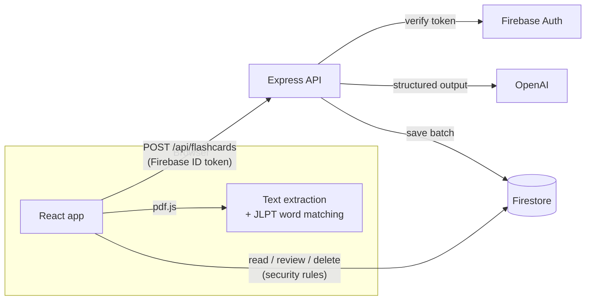

# LangGo

[](https://github.com/KentFarr/WebApp/actions/workflows/ci.yml)

LangGo turns Japanese reading material into vocabulary flashcards. Upload a Japanese PDF, choose a
JLPT level (N5–N1), and LangGo finds the most frequent words from that level, generates a
flashcard for each one (reading, meaning, and a memorable mnemonic) with OpenAI, suggests related
words, and schedules everything for review with spaced repetition.

## Features

- **PDF vocabulary mining.** PDFs are parsed in the browser with pdf.js and matched against JLPT
  word lists, so documents are never uploaded.
- **AI mnemonics.** The API uses OpenAI structured outputs with a Zod schema, so every response is
  validated before it is stored.
- **Spaced repetition.** Review intervals double when you remember a card and halve when you
  don't.
- **Accounts.** Firebase Authentication with email verification and password reset.
- **Per-user storage.** Cards live in Firestore and are protected by security rules.

## Tech stack

| Layer    | Technologies                                                                  |
| -------- | ----------------------------------------------------------------------------- |
| Frontend | React 19, TypeScript, Vite, React Router, React Bootstrap, styled-components  |
| Backend  | Node.js, Express 5, TypeScript, Zod, OpenAI SDK, Firebase Admin SDK           |
| Data     | Firebase Authentication, Cloud Firestore                                      |
| Tooling  | Vitest, Testing Library, Supertest, ESLint, GitHub Actions, Docker            |

## Architecture



- The **API** does only the work that needs secrets: it verifies the caller's Firebase ID token,
  generates cards with OpenAI, assigns each card an id and its first review date, and saves the
  batch. Requests are validated with Zod and rate-limited per user.
- The **client** reads and updates review state directly in Firestore. Updates run in
  transactions because each batch document stores its cards in arrays.
  [`firestore.rules`](firestore.rules) limits every user to their own data.
- In production, Express also serves the built frontend, so one container runs the whole app.

```
├── backend/                 Express API (TypeScript)
│   ├── src/
│   │   ├── app.ts           App factory (dependencies injected for testing)
│   │   ├── server.ts        Entry point: config, Firebase Admin, OpenAI wiring
│   │   ├── routes/          HTTP routes
│   │   ├── services/        OpenAI generator, Firestore repository
│   │   ├── middleware/      Auth and error handling
│   │   └── domain/          Flashcard model and scheduling
│   └── test/
├── frontend/                React SPA (Vite + TypeScript)
│   └── src/
│       ├── pages/           Route components
│       ├── components/      UI components
│       ├── services/        Firestore data access
│       ├── lib/             PDF parsing, word matching, spaced repetition, API client
│       └── data/            JLPT word lists
├── firestore.rules
├── Dockerfile
└── docker-compose.yml
```

## Getting started

### Prerequisites

- Node.js 24 (see [`.nvmrc`](.nvmrc))
- A Firebase project with **Email/Password** sign-in and **Cloud Firestore** enabled
- An OpenAI API key

### 1. Configure

```sh
cp backend/.env.example backend/.env           # OpenAI key, service-account path
cp frontend/.env.example frontend/.env.local   # Firebase web config
```

Download a service-account key from *Firebase console → Project settings → Service accounts*,
save it outside version control, and point `GOOGLE_APPLICATION_CREDENTIALS` in `backend/.env` at
it.

Deploy the Firestore security rules:

```sh
npx firebase-tools deploy --only firestore:rules
```

### 2. Run locally

```sh
cd backend && npm install && npm run dev     # API on http://localhost:5000
cd frontend && npm install && npm run dev    # App on http://localhost:3000 (proxies /api)
```

### 3. Run with Docker

Put the `VITE_FIREBASE_*` variables in a repo-root `.env`, then run:

```sh
FIREBASE_SERVICE_ACCOUNT_FILE=/path/to/service-account.json docker compose up --build
```

The app is served on http://localhost:3001.

## Scripts

Both `frontend/` and `backend/` provide:

| Script              | Description                     |
| ------------------- | ------------------------------- |
| `npm run dev`       | Start in watch mode             |
| `npm run build`     | Production build                |
| `npm test`          | Run the test suite (Vitest)     |
| `npm run lint`      | ESLint                          |
| `npm run typecheck` | TypeScript type checking        |

CI runs lint, type checking, tests, and a production build for both packages on every push and
pull request.

## API

`POST /api/flashcards`. Requires `Authorization: Bearer <Firebase ID token>`.

```json
{ "words": ["勉強", "学校"] }
```

It responds with `201` and the saved batch:

```json
{
  "docId": "…",
  "flashcards": [
    {
      "id": "…",
      "word": "勉強",
      "reading": "べんきょう",
      "meaning": "study",
      "mnemonic": "…",
      "reviewInterval": 1,
      "nextReviewDate": "…"
    }
  ],
  "relatedWords": []
}
```

`GET /healthz` returns `{ "status": "ok" }`.
