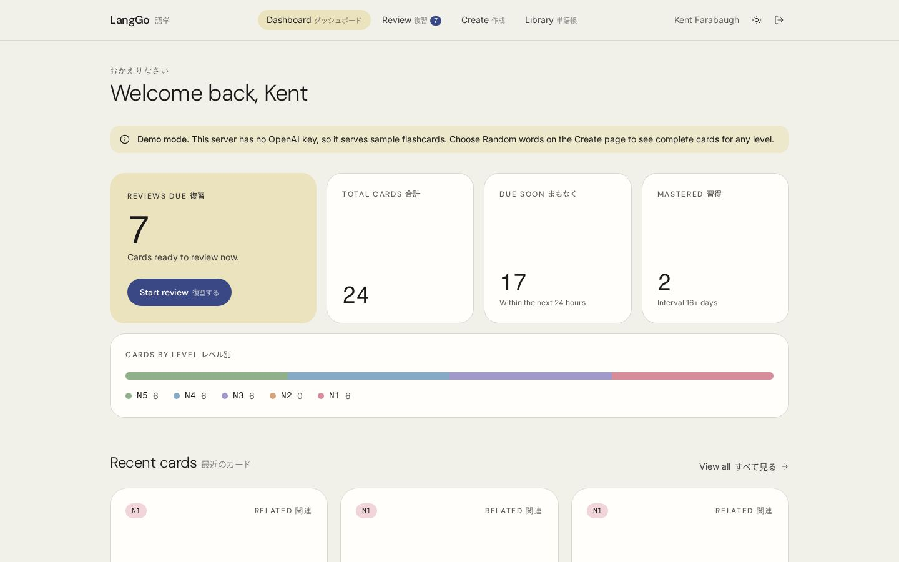
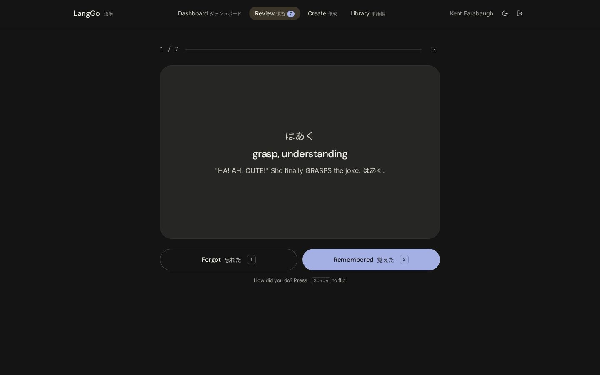
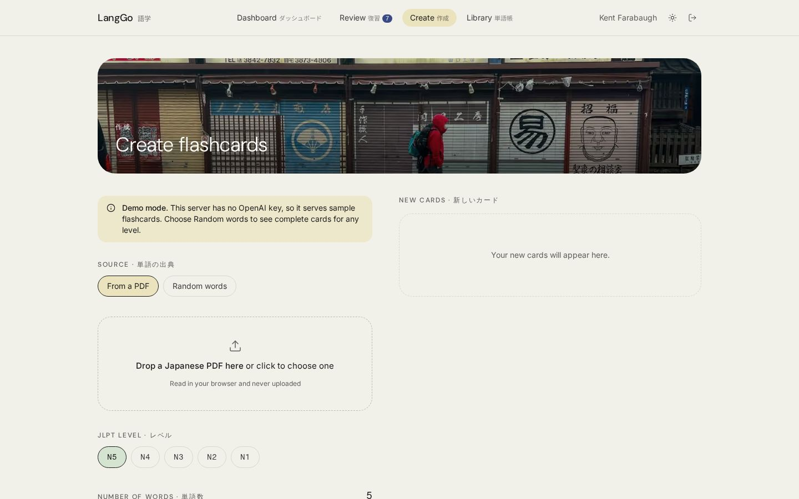
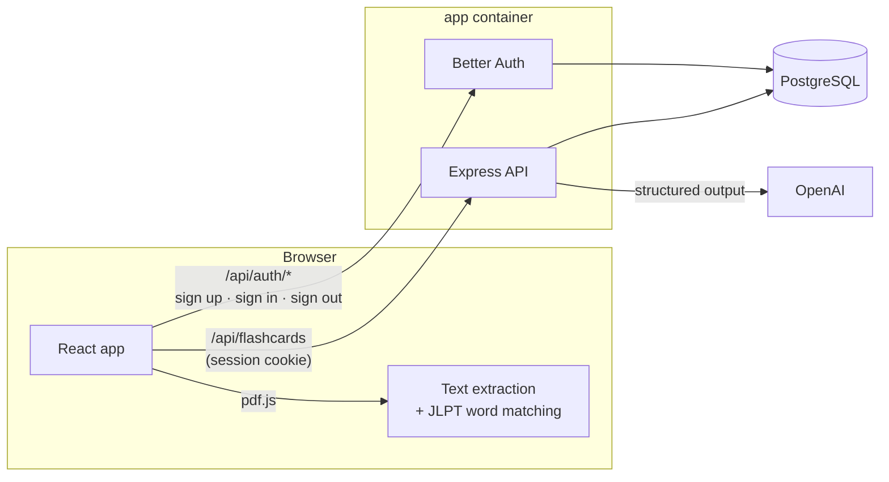

# LangGo

[](https://github.com/KentFarr/WebApp/actions/workflows/ci.yml)

LangGo turns Japanese reading material into vocabulary flashcards. Upload a Japanese PDF, choose a
JLPT level (N5–N1), and LangGo finds the most frequent words from that level, generates a
flashcard for each one (reading, meaning, and a memorable mnemonic) with OpenAI, suggests related
words, and schedules everything for review with spaced repetition.


| Dashboard | Review session (dark mode) |
| --- | --- |
|  |  |
| **Create** | **Mobile** |
|  |  |

## Features

- **Vocabulary from anything you read.** Find words in PDFs, EPUBs, Word documents, text and
  subtitle files (great for YouTube videos), or a web page link, or paste your own word list.
  Files are read in the browser and never uploaded; web pages are fetched by the server through
  an SSRF-hardened fetcher. Words are matched against JLPT lists and you review them before any
  cards are made.
- **Self-hosted accounts.** Email/password auth with Better Auth: hashed passwords,
  httpOnly session cookies, and brute-force rate limiting, all stored in your own Postgres.
- **AI mnemonics.** The API uses OpenAI structured outputs with a Zod schema, so every response is
  validated before it is stored.
- **Focused reviews.** One card at a time: Space flips, 1 and 2 grade; a dashboard shows what's due
  and your cards by JLPT level.
- **Spaced repetition.** Review intervals double when you remember a card and halve when you
  don't.
- **Light and dark themes.** A calm, bilingual (English/日本語) design that follows your system
  setting; every text color pair meets WCAG AA contrast.
- **Demo mode.** With no OpenAI key configured, the app serves hand-written sample cards, so
  anyone can try it end to end for free.
- **One-command setup.** `docker compose up` runs the app and PostgreSQL; migrations apply on
  startup.

## Tech stack

| Layer    | Technologies                                                                  |
| -------- | ----------------------------------------------------------------------------- |
| Frontend | React 19, TypeScript, Vite, React Router 8, Tailwind CSS 4, lucide icons      |
| Backend  | Node.js, Express 5, TypeScript, Zod, Better Auth, OpenAI SDK                  |
| Data     | PostgreSQL 18, Drizzle ORM + drizzle-kit migrations                           |
| Tooling  | Vitest, Testing Library, Supertest, PGlite, ESLint, GitHub Actions, Docker    |

## Architecture



- **Auth.** Better Auth is mounted inside the Express app at `/api/auth`. It stores users,
  hashed passwords, and sessions in Postgres and issues `HttpOnly`, `SameSite=Lax` session
  cookies. Sign-in attempts are rate-limited per client IP.
- **API.** Every flashcard route requires a session, and every query is scoped to the signed-in
  user, so asking for someone else's card returns 404. State-changing requests from untrusted
  origins are rejected (CSRF defense in depth). Generation is rate-limited per user because each
  call costs money.
- **Data.** Each card is a row with its own review schedule, so recording a review is a single
  row update under a row lock. Spaced-repetition rules live only on the server.
- In production, Express also serves the built frontend, so the whole app is one container plus
  Postgres.

```
├── backend/                 Express API (TypeScript)
│   ├── src/
│   │   ├── app.ts           App factory (dependencies injected for testing)
│   │   ├── server.ts        Entry point: config, migrations, auth, OpenAI wiring
│   │   ├── auth.ts          Better Auth configuration
│   │   ├── db/              Drizzle schema and connection
│   │   ├── routes/          HTTP routes
│   │   ├── services/        OpenAI generator, flashcard repository
│   │   ├── middleware/      Session, origin, and error handling
│   │   └── domain/          Flashcard model and spaced-repetition scheduling
│   ├── drizzle/             Generated SQL migrations
│   └── test/                Route, domain, and Postgres integration tests
├── frontend/                React SPA (Vite + TypeScript)
│   └── src/
│       ├── pages/           Landing, auth, dashboard, review, create, library
│       ├── components/      UI primitives (ui/), layouts, flip cards
│       ├── flashcards/      Shared deck context for signed-in pages
│       ├── hooks/           Data hooks
│       ├── lib/             API/auth clients, PDF parsing, word matching, stats, theme
│       ├── assets/photos/   Optimized photos (scripts/optimize-photos.sh)
│       └── data/            JLPT word lists
├── deploy/                  Caddyfile and backup script for production
├── docs/DEPLOYMENT.md       VPS deployment guide
├── Dockerfile
├── docker-compose.yml       App + Postgres (local)
└── docker-compose.prod.yml  Production overlay: Caddy, backups, no public app/DB ports
```

## Getting started

### Prerequisites

- Docker (for PostgreSQL, or to run everything)
- Node.js 24 for local development (see [`.nvmrc`](.nvmrc))
- An OpenAI API key (optional: without one, the app runs in demo mode)

### Configure

```sh
cp backend/.env.example backend/.env
# Set BETTER_AUTH_SECRET (openssl rand -base64 32); add OPENAI_API_KEY, or leave it empty for demo mode
```

### Run everything with Docker

```sh
docker compose up --build
```

Open http://localhost:3001. Database migrations run automatically when the app starts, and data
is kept in the `pgdata` volume.

### Local development

```sh
docker compose up -d db                       # PostgreSQL on localhost:5433 (DB_PORT)
cd backend && npm install && npm run dev      # API on http://localhost:5000
cd frontend && npm install && npm run dev     # App on http://localhost:3000 (proxies /api)
```

After changing `backend/src/db/schema.ts`, run `npm run db:generate` in `backend/` to create a new
migration.

### Deploy to a VPS

[`docs/DEPLOYMENT.md`](docs/DEPLOYMENT.md) walks through deploying to an OVHcloud VPS (or any
Linux server) with `docker-compose.prod.yml`. It covers automatic HTTPS with Caddy, keeping the
app and database off the public internet, daily database backups, log rotation, and updates.

## Scripts

Both `frontend/` and `backend/` provide:

| Script              | Description                     |
| ------------------- | ------------------------------- |
| `npm run dev`       | Start in watch mode             |
| `npm run build`     | Production build                |
| `npm test`          | Run the test suite (Vitest)     |
| `npm run lint`      | ESLint                          |
| `npm run typecheck` | TypeScript type checking        |

The backend integration tests run real Better Auth sessions and the real SQL migrations against
[PGlite](https://pglite.dev) (Postgres compiled to WebAssembly), so the full suite needs no
database server or Docker. CI runs lint, type checking, tests, and a production build for both
packages on every push and pull request.

## API

Authentication endpoints are provided by Better Auth under `/api/auth` (for example
`POST /api/auth/sign-up/email`, `POST /api/auth/sign-in/email`, `POST /api/auth/sign-out`). All
flashcard routes require the session cookie.

| Method   | Path                          | Body                     | Response                     |
| -------- | ----------------------------- | ------------------------ | ---------------------------- |
| `GET`    | `/api/flashcards`             |                          | `200 { flashcards }`         |
| `POST`   | `/api/flashcards`             | `{ "words": ["勉強"] }`   | `201 { flashcards }` (new)   |
| `POST`   | `/api/flashcards/:id/review`  | `{ "remembered": true }` | `200 { flashcard }`          |
| `DELETE` | `/api/flashcards/:id`         |                          | `204`                        |
| `GET`    | `/api/meta` (public)          |                          | `200 { demoMode, sampleWords }` |
| `GET`    | `/healthz`                    |                          | `200 { "status": "ok" }`     |

A flashcard looks like this:

```json
{
  "id": "4f0c…",
  "word": "勉強",
  "reading": "べんきょう",
  "meaning": "study",
  "mnemonic": "…",
  "source": "requested",
  "reviewInterval": 1,
  "nextReviewDate": "2026-10-14T21:00:00.000Z",
  "createdAt": "2026-10-13T21:00:00.000Z"
}
```
